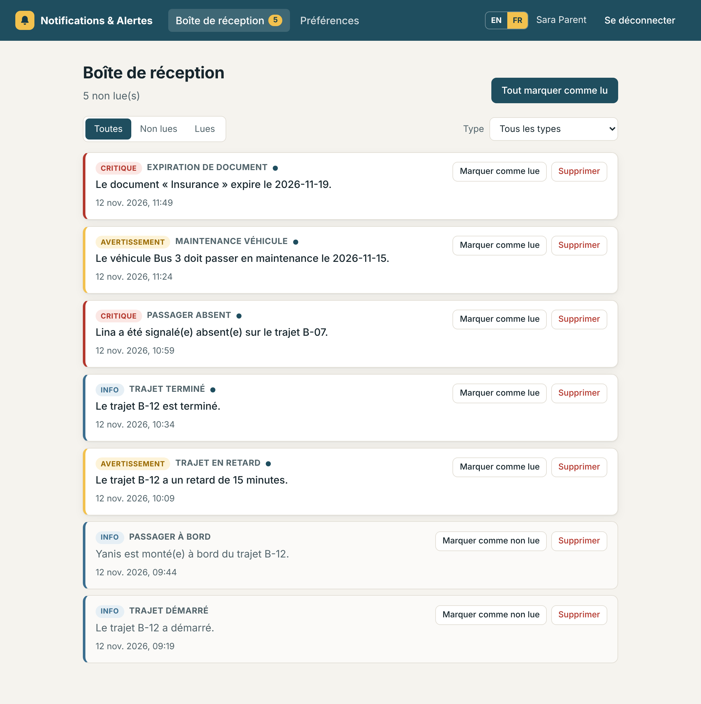
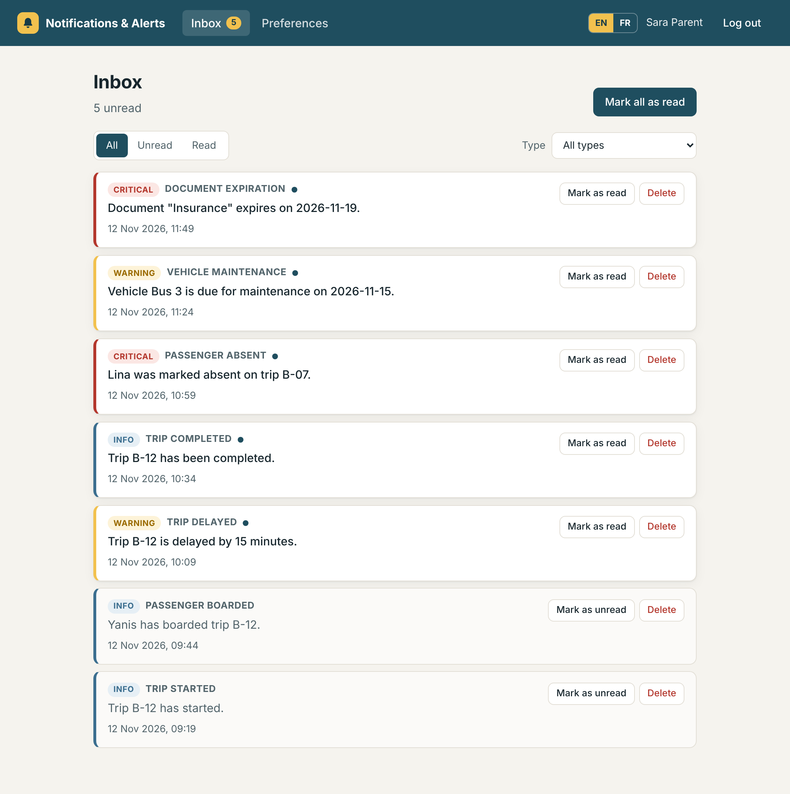
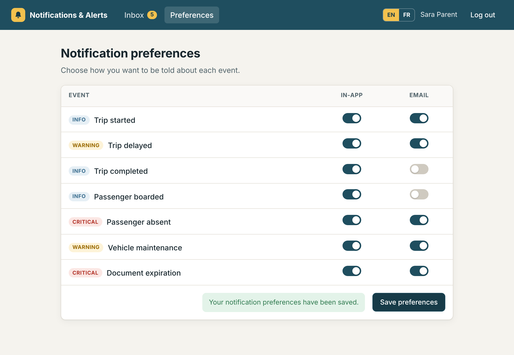
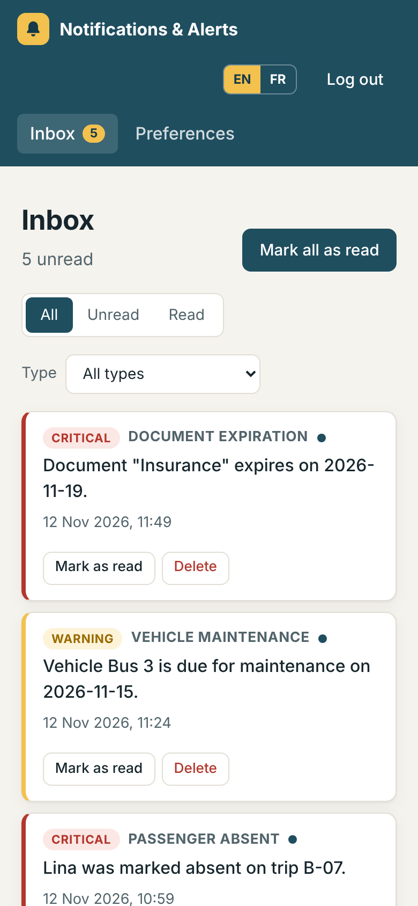
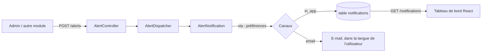

<div align="center">

# 🔔 Module Notifications & Alertes

**Un système de notifications bilingue (FR/EN) pour le transport scolaire et la gestion de flotte.**
API REST Laravel 13 · tableau de bord React 19 · préférences de diffusion par utilisateur · entièrement testé.

[](https://github.com/YOUR_USERNAME/Notifications-Alerts-Module/actions/workflows/ci.yml)


[English](README.md) · **Français**



</div>

---

## Sommaire

- [Présentation](#présentation)
- [Fonctionnalités](#fonctionnalités)
- [Stack technique](#stack-technique)
- [Installation](#installation)
- [API](#api)
- [Types de notifications](#types-de-notifications)
- [Fonctionnement](#fonctionnement)
- [Tests](#tests)
- [Structure du projet](#structure-du-projet)
- [Feuille de route](#feuille-de-route)
- [Licence](#licence)

## Présentation

Les parents, les chauffeurs et les régulateurs doivent savoir ce qui se passe sur la route : un trajet a démarré, un bus est en retard, un enfant a été signalé absent, l'assurance d'un véhicule arrive à expiration.

Ce module centralise ces événements. Le backend déclenche des **alertes typées**, les enregistre dans la **boîte de réception** de chaque utilisateur et les envoie par **e-mail** quand c'est important. Chaque utilisateur choisit les canaux à utiliser pour chaque événement. Tous les messages sont disponibles en **français et en anglais**, dans l'application comme dans les e-mails.

| Boîte de réception (EN) | Préférences | Mobile |
|---|---|---|
|  |  |  |

## Fonctionnalités

**API backend**
- 🔐 Authentification par jeton avec **Laravel Sanctum**, connexion limitée en nombre de tentatives
- 📥 Boîte de réception : pagination, filtres par statut et par type, compteur de non lues, lu/non lu, tout marquer comme lu, suppression
- 🎚️ **Préférences par événement et par canal** (application / e-mail), avec des valeurs par défaut selon la gravité
- 🚨 Endpoint réservé aux administrateurs pour envoyer une alerte à plusieurs utilisateurs, avec une validation adaptée à chaque type d'alerte
- 🌍 **i18n** : les messages sont stockés sous forme `type + données` et traduits dans la langue du lecteur au moment de la lecture ; les e-mails partent dans la langue enregistrée du destinataire
- 📨 Notifications compatibles avec les files d'attente (`ShouldQueue`), envoyées via les canaux `database` et `mail` de Laravel
- 🛡️ Isolation stricte des données : un utilisateur ne peut jamais lire ni modifier les notifications d'un autre

**Tableau de bord frontend**
- ⚡ React 19 + Vite + React Router
- Connexion avec comptes de démonstration, routes protégées, restauration de session
- Badge de non lues en direct (polling), code couleur par gravité, filtres et pagination
- Matrice de préférences avec interrupteurs
- Sélecteur de langue FR/EN enregistré sur le compte utilisateur
- Accessible : champs étiquetés, focus clavier visible, boutons `aria-pressed`, mise en page responsive

**Qualité**
- ✅ **59 tests backend** (PHPUnit), **36 tests frontend** (Vitest + Testing Library, ~98 % de couverture des lignes)
- 🎨 Laravel Pint et ESLint
- 🔄 Intégration continue GitHub Actions à chaque push et pull request (PHP 8.3 et 8.4, Node 22)

## Stack technique

| Couche | Technologie |
|---|---|
| API | PHP 8.3+, Laravel 13, Laravel Sanctum 4 |
| Base de données | SQLite (par défaut) — MySQL / PostgreSQL compatibles |
| Frontend | React 19, Vite 8, React Router 7, Axios |
| Tests | PHPUnit 12, Vitest 5, Testing Library |
| Outils | Laravel Pint, ESLint 10, GitHub Actions |

## Installation

### Prérequis

- PHP **8.3+** avec `pdo_sqlite`, et [Composer](https://getcomposer.org/)
- Node.js **22.12+** et npm

### 1. Backend

```bash
cd backend
composer setup          # installe, crée .env, génère la clé, crée la base SQLite, migre et remplit les données de démo
php artisan serve       # http://localhost:8000
```

<details>
<summary>Étapes manuelles (si vous préférez)</summary>

```bash
cd backend
composer install
cp .env.example .env
php artisan key:generate
touch database/database.sqlite
php artisan migrate --seed
php artisan serve
```
</details>

### 2. Frontend

```bash
cd frontend
cp .env.example .env    # VITE_API_URL=http://localhost:8000/api/v1
npm install
npm run dev             # http://localhost:5173
```

### 3. Se connecter avec un compte de démonstration

| Rôle | E-mail | Mot de passe | Langue |
|---|---|---|---|
| Parent (7 notifications d'exemple) | `parent@example.com` | `password` | Français |
| Admin / régulateur (peut envoyer des alertes) | `admin@example.com` | `password` | Anglais |

> Par défaut, les e-mails sont écrits dans `storage/logs/laravel.log` (`MAIL_MAILER=log`). En production, configurez un vrai service d'envoi et `QUEUE_CONNECTION=database`, puis lancez `php artisan queue:work`.

## API

URL de base : `http://localhost:8000/api/v1`. Tous les endpoints sauf la connexion exigent l'en-tête `Authorization: Bearer <jeton>`.

| Méthode | Endpoint | Description |
|---|---|---|
| `POST` | `/auth/login` | Obtenir un jeton (`email`, `password`) — 5 tentatives/min |
| `POST` | `/auth/logout` | Révoquer le jeton courant |
| `GET` | `/me` | Utilisateur connecté |
| `PATCH` | `/me` | Modifier `name` ou `locale` (`en` / `fr`) |
| `GET` | `/notifications` | Boîte paginée — `?status=all\|unread\|read&type=…&per_page=…&page=…` |
| `GET` | `/notifications/unread-count` | `{ "unread_count": 5 }` |
| `PATCH` | `/notifications/{id}/read` | Marquer comme lue |
| `PATCH` | `/notifications/{id}/unread` | Marquer comme non lue |
| `PATCH` | `/notifications/read-all` | Tout marquer comme lu |
| `DELETE` | `/notifications/{id}` | Supprimer une notification |
| `GET` | `/notification-preferences` | Matrice complète des préférences (types × canaux) |
| `PUT` | `/notification-preferences` | Modifier une ou plusieurs préférences |
| `GET` | `/alerts/types` | Types d'alertes disponibles et données requises |
| `POST` | `/alerts` | **Admin uniquement** — envoyer une alerte |

**Langue :** `?lang=fr` en priorité, sinon la langue enregistrée de l'utilisateur, sinon l'en-tête `Accept-Language`.

### Exemples

```bash
# Connexion
TOKEN=$(curl -s -X POST http://localhost:8000/api/v1/auth/login \
  -H "Accept: application/json" -H "Content-Type: application/json" \
  -d '{"email":"admin@example.com","password":"password"}' | jq -r .token)

# Envoyer une alerte « trajet en retard » à l'utilisateur n°2
curl -X POST "http://localhost:8000/api/v1/alerts?lang=fr" \
  -H "Authorization: Bearer $TOKEN" -H "Accept: application/json" -H "Content-Type: application/json" \
  -d '{"type":"trip_delayed","user_ids":[2],"data":{"trip":"B-12","delay":15}}'
# → 202 { "message": "Alerte envoyée à 1 destinataire(s).", "recipients": 1 }
```

Une notification telle que renvoyée par l'API (en français) :

```json
{
  "id": "9b1f6c1e-…",
  "type": "trip_delayed",
  "label": "Trajet en retard",
  "severity": "warning",
  "message": "Le trajet B-12 a un retard de 15 minutes.",
  "payload": { "trip": "B-12", "delay": 15 },
  "is_read": false,
  "read_at": null,
  "created_at": "2026-11-12T10:08:00+00:00"
}
```

## Types de notifications

| Type | Gravité | Données requises | E-mail par défaut |
|---|---|---|---|
| `trip_started` | info | `trip` | ✗ |
| `trip_delayed` | warning | `trip`, `delay` | ✓ |
| `trip_completed` | info | `trip` | ✗ |
| `passenger_boarded` | info | `passenger`, `trip` | ✗ |
| `passenger_absent` | critical | `passenger`, `trip` | ✓ |
| `vehicle_maintenance` | warning | `vehicle`, `date` | ✓ |
| `document_expiration` | critical | `document`, `date` | ✓ |

La diffusion dans l'application est activée par défaut pour tous les types. Un `message` libre peut remplacer les `data`.

## Fonctionnement



- **`App\Enums\NotificationType`** est la source unique de vérité : gravité, données requises, canaux par défaut, libellé et message traduits.
- **`App\Notifications\AlertNotification`** choisit ses canaux dans `via()` selon les préférences du destinataire, et enregistre `type + données` (pas un texte déjà rédigé). La boîte de réception peut donc s'afficher plus tard dans n'importe quelle langue.
- **`App\Services\AlertDispatcher`** est le point d'entrée que le reste d'une application peut appeler :
  ```php
  app(AlertDispatcher::class)->dispatch(NotificationType::PassengerAbsent, $parents, ['passenger' => 'Lina', 'trip' => 'B-07']);
  ```
- **`App\Services\PreferenceService`** construit la matrice des préférences en complétant avec les valeurs par défaut.

## Tests

```bash
# Backend
cd backend
composer test           # PHPUnit — 59 tests
composer lint           # Pint (style de code)

# Frontend
cd frontend
npm run test:run        # Vitest — 36 tests
npm run coverage        # avec rapport de couverture
npm run lint            # ESLint
```

Les tests backend couvrent l'authentification, la limitation des tentatives, l'isolation entre utilisateurs, les filtres, la pagination, les préférences (valeurs par défaut et validation), l'autorisation admin, la validation des données par type, le choix des canaux de bout en bout, les traductions (chaque type dans les deux langues) et les données de démonstration.

## Structure du projet

```
.
├── backend/                     API Laravel 13
│   ├── app/
│   │   ├── Enums/               NotificationType, NotificationChannel, Severity
│   │   ├── Http/Controllers/Api/V1/
│   │   ├── Http/Middleware/     SetLocale
│   │   ├── Http/Requests/       Validation (form requests)
│   │   ├── Http/Resources/      Ressources API
│   │   ├── Notifications/       AlertNotification
│   │   ├── Rules/               ScalarValue
│   │   └── Services/            AlertDispatcher, PreferenceService
│   ├── database/                migrations, factories, données de démo
│   ├── lang/{en,fr}/            traductions
│   ├── routes/api.php
│   └── tests/{Unit,Feature}/
├── frontend/                    React 19 + Vite
│   └── src/
│       ├── api/                 client axios + endpoints
│       ├── components/          Layout, NotificationItem, LanguageSwitch…
│       ├── context/             Authentification, compteur de non lues
│       ├── i18n/                dictionnaires FR/EN
│       └── pages/               Connexion, Notifications, Préférences
├── docs/screenshots/
└── .github/workflows/ci.yml
```

## Feuille de route

- [ ] Temps réel avec Laravel Reverb (WebSockets) à la place du polling
- [ ] Canaux SMS / push
- [ ] Commande planifiée pour déclencher automatiquement les alertes `document_expiration`
- [ ] Environnement Docker Compose
- [ ] Spécification OpenAPI

## Licence

Distribué sous [licence MIT](LICENSE).
