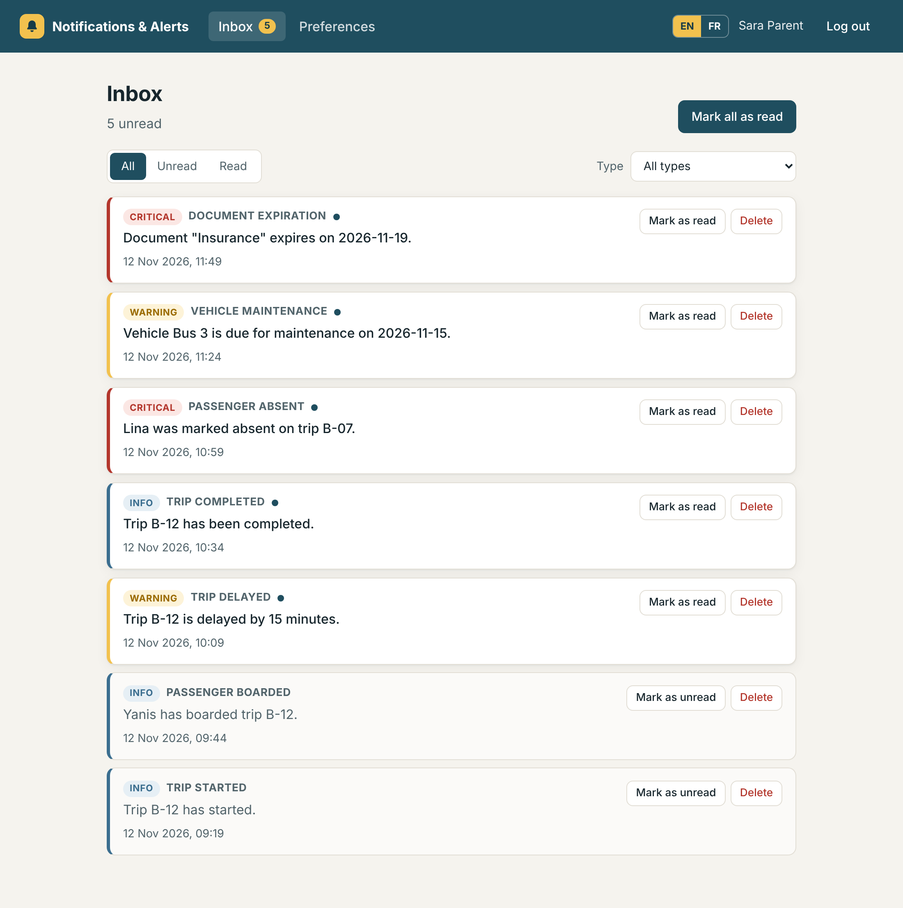
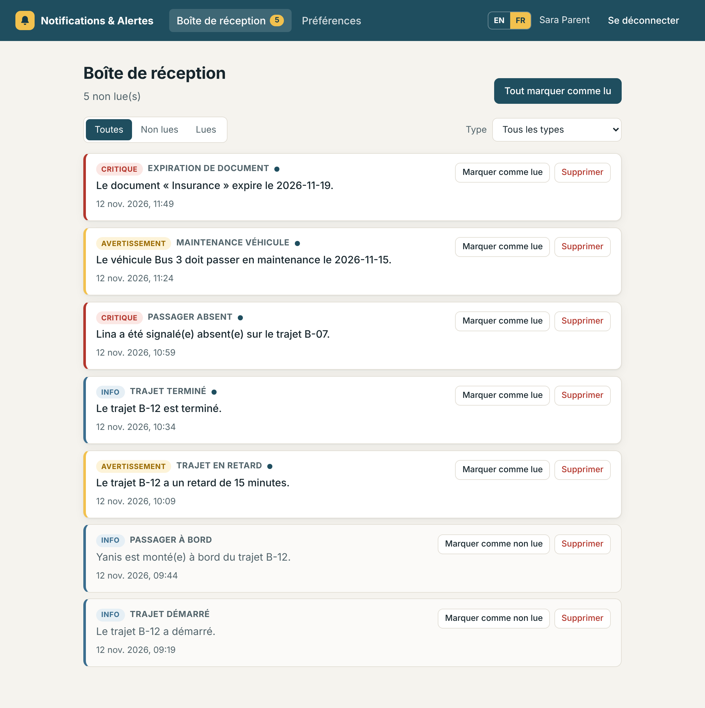
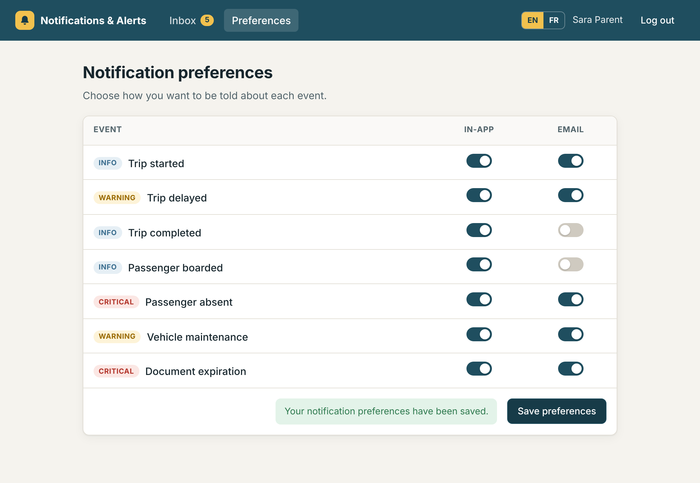
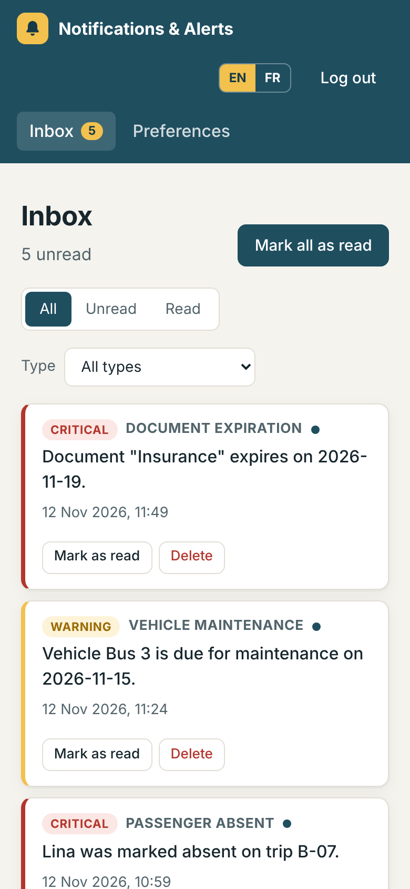
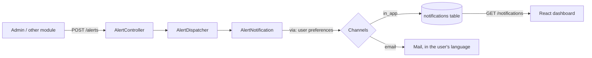

<div align="center">

# 🔔 Notifications & Alerts Module

**A bilingual (EN/FR) notification system for school transport and fleet management.**
Laravel 13 REST API · React 19 dashboard · per-user delivery preferences · fully tested.

[](https://github.com/YOUR_USERNAME/Notifications-Alerts-Module/actions/workflows/ci.yml)


**English** · [Français](README.fr.md)



</div>

---

## Table of contents

- [Overview](#overview)
- [Features](#features)
- [Tech stack](#tech-stack)
- [Getting started](#getting-started)
- [API](#api)
- [Notification types](#notification-types)
- [How it works](#how-it-works)
- [Testing](#testing)
- [Project structure](#project-structure)
- [Roadmap](#roadmap)
- [License](#license)

## Overview

Parents, drivers and dispatchers need to know what is happening on the road: a trip has started, a bus is late, a child was marked absent, a vehicle's insurance is about to expire.

This module centralises those events. The backend raises **typed alerts**, stores them in each user's **inbox**, and sends them by **e-mail** when it matters. Each user chooses which channels to use for each event. Every message is available in **English and French**, both in the app and in the e-mails.

| Inbox (French) | Preferences | Mobile |
|---|---|---|
|  |  |  |

## Features

**Backend API**
- 🔐 Token authentication with **Laravel Sanctum**, plus rate-limited login
- 📥 Inbox with pagination, filters by status/type, unread counter, read/unread toggle, mark all as read, delete
- 🎚️ **Per-event, per-channel preferences** (in-app / e-mail), with smart defaults by severity
- 🚨 Admin-only endpoint to dispatch alerts to many users, with validation adapted to each alert type
- 🌍 **i18n**: messages are stored as `type + data` and rendered in the reader's language at read time; e-mails use the recipient's saved language
- 📨 Queue-ready notifications (`ShouldQueue`) delivered through Laravel's `database` and `mail` channels
- 🛡️ Strict data isolation: a user can never read or modify another user's notifications

**Frontend dashboard**
- ⚡ React 19 + Vite + React Router
- Login with demo accounts, protected routes, session restore
- Live unread badge (polling), severity colour coding, filters and pagination
- Preferences matrix with toggle switches
- EN/FR language switch saved on the user account
- Accessible: labelled controls, keyboard focus states, `aria-pressed` toggles, responsive layout

**Quality**
- ✅ **59 backend tests** (PHPUnit), **36 frontend tests** (Vitest + Testing Library, ~98% line coverage)
- 🎨 Laravel Pint and ESLint
- 🔄 GitHub Actions CI on every push and pull request (PHP 8.3 & 8.4, Node 22)

## Tech stack

| Layer | Technology |
|---|---|
| API | PHP 8.3+, Laravel 13, Laravel Sanctum 4 |
| Database | SQLite (default) — MySQL / PostgreSQL supported |
| Frontend | React 19, Vite 8, React Router 7, Axios |
| Tests | PHPUnit 12, Vitest 5, Testing Library |
| Tooling | Laravel Pint, ESLint 10, GitHub Actions |

## Getting started

### Prerequisites

- PHP **8.3+** with `pdo_sqlite`, and [Composer](https://getcomposer.org/)
- Node.js **22.12+** and npm

### 1. Backend

```bash
cd backend
composer setup          # install, create .env, generate key, create SQLite DB, migrate and seed
php artisan serve       # http://localhost:8000
```

<details>
<summary>Manual steps (if you prefer)</summary>

```bash
cd backend
composer install
cp .env.example .env
php artisan key:generate
touch database/database.sqlite
php artisan migrate --seed
php artisan serve
```
</details>

### 2. Frontend

```bash
cd frontend
cp .env.example .env    # VITE_API_URL=http://localhost:8000/api/v1
npm install
npm run dev             # http://localhost:5173
```

### 3. Log in with a demo account

| Role | E-mail | Password | Language |
|---|---|---|---|
| Parent (has 7 sample notifications) | `parent@example.com` | `password` | French |
| Admin / dispatcher (can send alerts) | `admin@example.com` | `password` | English |

> E-mails are written to `storage/logs/laravel.log` by default (`MAIL_MAILER=log`). For production, configure a real mailer and set `QUEUE_CONNECTION=database`, then run `php artisan queue:work`.

## API

Base URL: `http://localhost:8000/api/v1`. Every endpoint except login requires an `Authorization: Bearer <token>` header.

| Method | Endpoint | Description |
|---|---|---|
| `POST` | `/auth/login` | Get a token (`email`, `password`) — 5 attempts/min |
| `POST` | `/auth/logout` | Revoke the current token |
| `GET` | `/me` | Current user |
| `PATCH` | `/me` | Update `name` or `locale` (`en` / `fr`) |
| `GET` | `/notifications` | Paginated inbox — `?status=all\|unread\|read&type=…&per_page=…&page=…` |
| `GET` | `/notifications/unread-count` | `{ "unread_count": 5 }` |
| `PATCH` | `/notifications/{id}/read` | Mark as read |
| `PATCH` | `/notifications/{id}/unread` | Mark as unread |
| `PATCH` | `/notifications/read-all` | Mark everything as read |
| `DELETE` | `/notifications/{id}` | Delete a notification |
| `GET` | `/notification-preferences` | Full preference matrix (all types × channels) |
| `PUT` | `/notification-preferences` | Update one or more preferences |
| `GET` | `/alerts/types` | Available alert types and the data each one requires |
| `POST` | `/alerts` | **Admin only** — send an alert to users |

**Language:** responses use `?lang=fr`, otherwise the user's saved locale, otherwise the `Accept-Language` header.

### Examples

```bash
# Log in
TOKEN=$(curl -s -X POST http://localhost:8000/api/v1/auth/login \
  -H "Accept: application/json" -H "Content-Type: application/json" \
  -d '{"email":"admin@example.com","password":"password"}' | jq -r .token)

# Send a "trip delayed" alert to user #2
curl -X POST http://localhost:8000/api/v1/alerts \
  -H "Authorization: Bearer $TOKEN" -H "Accept: application/json" -H "Content-Type: application/json" \
  -d '{"type":"trip_delayed","user_ids":[2],"data":{"trip":"B-12","delay":15}}'
# → 202 { "message": "Alert sent to 1 recipient(s).", "recipients": 1 }
```

A notification as returned by the API:

```json
{
  "id": "9b1f6c1e-…",
  "type": "trip_delayed",
  "label": "Trip delayed",
  "severity": "warning",
  "message": "Trip B-12 is delayed by 15 minutes.",
  "payload": { "trip": "B-12", "delay": 15 },
  "is_read": false,
  "read_at": null,
  "created_at": "2026-11-12T10:08:00+00:00"
}
```

Updating preferences:

```json
PUT /notification-preferences
{ "preferences": [ { "type": "trip_started", "in_app": true, "email": true } ] }
```

## Notification types

| Type | Severity | Required data | E-mail by default |
|---|---|---|---|
| `trip_started` | info | `trip` | ✗ |
| `trip_delayed` | warning | `trip`, `delay` | ✓ |
| `trip_completed` | info | `trip` | ✗ |
| `passenger_boarded` | info | `passenger`, `trip` | ✗ |
| `passenger_absent` | critical | `passenger`, `trip` | ✓ |
| `vehicle_maintenance` | warning | `vehicle`, `date` | ✓ |
| `document_expiration` | critical | `document`, `date` | ✓ |

In-app delivery is on by default for every type. You can send a free-text `message` instead of `data`.

## How it works



- **`App\Enums\NotificationType`** is the single source of truth: severity, required data, default channels, translated label and message.
- **`App\Notifications\AlertNotification`** decides its channels in `via()` from the recipient's preferences, and stores `type + data` (not a rendered string). This lets the inbox be shown in any language later.
- **`App\Services\AlertDispatcher`** is the entry point other parts of an application can call:
  ```php
  app(AlertDispatcher::class)->dispatch(NotificationType::PassengerAbsent, $parents, ['passenger' => 'Lina', 'trip' => 'B-07']);
  ```
- **`App\Services\PreferenceService`** builds the preference matrix, filling in defaults for types the user never configured.

## Testing

```bash
# Backend
cd backend
composer test           # PHPUnit — 59 tests
composer lint           # Pint (code style)

# Frontend
cd frontend
npm run test:run        # Vitest — 36 tests
npm run coverage        # with coverage report
npm run lint            # ESLint
```

The backend tests cover authentication, rate limiting, user isolation, filters, pagination, preference defaults and validation, admin authorization, per-type payload validation, end-to-end channel selection, translations (every type in both languages) and the demo seeder.

## Project structure

```
.
├── backend/                     Laravel 13 API
│   ├── app/
│   │   ├── Enums/               NotificationType, NotificationChannel, Severity
│   │   ├── Http/Controllers/Api/V1/
│   │   ├── Http/Middleware/     SetLocale
│   │   ├── Http/Requests/       Form requests (validation)
│   │   ├── Http/Resources/      API resources
│   │   ├── Notifications/       AlertNotification
│   │   ├── Rules/               ScalarValue
│   │   └── Services/            AlertDispatcher, PreferenceService
│   ├── database/                migrations, factories, demo seeder
│   ├── lang/{en,fr}/            translations
│   ├── routes/api.php
│   └── tests/{Unit,Feature}/
├── frontend/                    React 19 + Vite
│   └── src/
│       ├── api/                 axios client + endpoints
│       ├── components/          Layout, NotificationItem, LanguageSwitch…
│       ├── context/             Auth, unread counter
│       ├── i18n/                EN/FR dictionaries
│       └── pages/               Login, Notifications, Preferences
├── docs/screenshots/
└── .github/workflows/ci.yml
```

## Roadmap

- [ ] Real-time push with Laravel Reverb (WebSockets) instead of polling
- [ ] SMS / push channels
- [ ] Scheduled command to raise `document_expiration` alerts automatically
- [ ] Docker Compose setup
- [ ] OpenAPI specification

## License

Released under the [MIT License](LICENSE).
